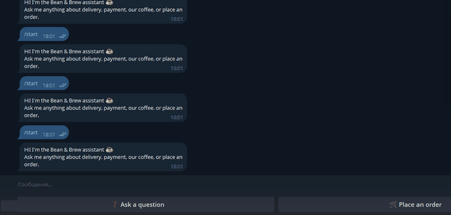

# Support FAQ Telegram Bot with measured answer quality

**Problem.** A small online coffee shop answers the same 10 questions in Telegram every day (delivery, payment, returns, roasts) and loses orders when nobody replies at night.

**Solution.** A Telegram bot that:

- answers customer questions from a knowledge base (a JSON file the owner can edit),
- **hands over to a human when it is not confident** instead of making things up, and logs those questions,
- collects order requests (name → validated phone → order) and sends them to the owner's chat,
- shows the owner `/stats`: orders and the most frequent unanswered questions, i.e. what to add to the FAQ next,
- optionally lets an LLM phrase answers naturally, restricted to facts from the knowledge base.



*Real run in Telegram (embeddings backend): two FAQ answers, including a paraphrase with no shared words ("the pack came broken" → returns policy), an off-topic question handed to a manager, and the order form rejecting an invalid phone. The owner's notifications and `/stats` were checked in the same run but are not in the recording.*

## How answer quality is measured

Most FAQ bots are shipped with "seems to work". This one ships with an evaluation set (`data/eval_questions.json`): 20 real-style customer questions phrased differently from the FAQ, plus 6 off-topic ones the bot must **not** answer.

```bash
python evaluate.py --backend tfidf
python evaluate.py --backend embeddings
```

Measured results (26 questions, thresholds swept from 0.05 to 0.90):

| Backend | Threshold | Overall | Correct answer found | Off-topic handed to human |
|---|---|---|---|---|
| TF-IDF (word + char n-grams) | 0.20 (default) | 69% | 70% | 67% |
| TF-IDF, best threshold | 0.15 | 73% | 80% | 50% |
| Multilingual embeddings (`paraphrase-multilingual-MiniLM-L12-v2`) | **0.40 (default)** | **77%** | **80%** | **67%** |

What the numbers say, honestly:

- Embeddings are the best option here, but the gain is modest: 77% vs 69–73%, i.e. 2–3 more questions out of 26. On a set this small that is a tendency, not proof.
- Both backends pick the right FAQ entry as their top match for the same 16 of 20 questions. The difference is in **confidence**: embedding scores separate real questions from off-topic ones better, so one threshold can keep 80% of answers and still hand 4 of 6 off-topic messages to a human. TF-IDF has to trade one for the other.
- Embeddings fix paraphrases with no shared words (they score "the pack came broken" → returns at 0.47 vs 0.17 for TF-IDF, and get "do you deliver quickly?" right) but make new mistakes: "cash on delivery possible?" goes to delivery cost, and "do you sell tea" is confidently matched to wholesale (0.64).
- Remaining misses for both: "where is my order now" → delivery time instead of tracking, "what time does support work" → delivery time instead of opening hours. These are fixed by adding question variants to `knowledge_base.json`, not by a better model.
- The model is multilingual, but this eval set is English only, so quality in Ukrainian or other languages is **not measured**.

The embeddings model (~460 MB in the Hugging Face cache) is downloaded from Hugging Face on first start. A test keeps the TF-IDF baseline from regressing when the knowledge base is edited.

## Run

```bash
pip install -r requirements.txt
cp .env.example .env                # then put BOT_TOKEN from @BotFather into .env
python bot.py                       # send /id to the bot, put the number into ADMIN_CHAT_ID, restart
pytest -q                           # 13 tests, no Telegram needed
```

`KB_BACKEND=auto` (default) uses embeddings when available and falls back to TF-IDF.

## Structure

| File | What it does |
|---|---|
| `bot.py` | aiogram 3 handlers: menu, FAQ, order form (FSM), manager handover, `/stats` |
| `faqbot/knowledge.py` | Retrieval with two backends, confidence threshold, evaluation, optional LLM phrasing |
| `faqbot/storage.py` | SQLite: orders and unanswered questions; phone normalisation |
| `data/knowledge_base.json` | The FAQ, editable without touching code |
| `data/eval_questions.json` | Labelled test questions for measuring quality |
| `tests/` | Retrieval, storage and handler tests (the order flow runs through the real aiogram FSM) |

To reuse it for another business, replace the two JSON files and the welcome text.
